# 招财猫记账本：项目逻辑说明

> **先读这一份。** 本文按业务发生顺序说明项目，配图展示流程，正文补充判断条件和失败去向；文件沿用旧名称以保持引用稳定。本文描述当前 main 代码；部署与手机验收看[实施规划](招财猫记账本实施规划.md)，历史说明见[固定归档](归档/README.md)。

## 阅读地图

[项目全貌](#overview) → [用户与身份](#identity) → [导入全过程](#import) → [手工账本与统计](#ledger) → [贷款与分期](#loans) → [已入账维护](#maintenance) → [缓存与恢复](#recovery) → [数据生命周期](#lifecycle) → [例子](#examples) → [排查](#troubleshooting)。

普通读者沿正文阅读；修改实现时，通过各节链接查[架构](招财猫记账本架构设计.md)、[业务规则](招财猫记账本业务规则与验收.md)和相关专题。接口参数、容量和验证方法分别以 shared 契约、代码及[开发与验证](开发与验证.md)为准。

## 1. 项目全貌：先整理事实，再影响账本

CatLedger 是微信原生小程序，把银行、支付宝、微信支付账单整理为可追溯的个人账本，也支持手工记账、账户与分类、统计、贷款与信用卡分期。它记录资金活动，不执行真实付款、转账或借款。

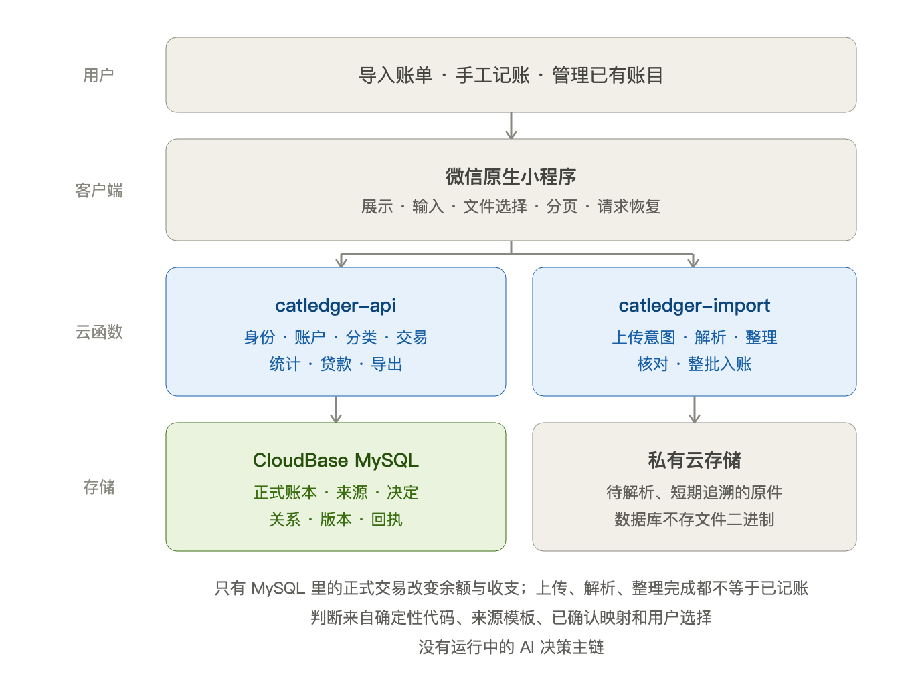

系统依据来源模板、确定性规则、已确认的映射和用户选择作判断，当前没有 AI 决策主链。

**上传、解析、整理成功都不等于已经记账。只有有效正式交易改变记账余额和收支。** 贷款计划、分期进度和导入草稿不另算一份余额；按方案记费也要有用户授权，并说明是否已与实际账单核对。

实现入口：[业务动作](../cloudfunctions/catledger-api/src/action-registry.js)、[导入动作](../cloudfunctions/catledger-import/src/action-registry.js)、[页面路由](../miniprogram/app.json)。

## 2. 用户入口与身份

底部入口是首页、明细、统计、我的；中央记账按钮打开“账单导入／记一笔”。账户、分类、贷款使用各自页面。

启动时确认微信身份，成功后自动进入账本；失败可重试或返回。需要登录的操作在确认身份后继续，取消则不执行。新用户初始化默认资料，已完成初始化的用户正常读取，不因打开账本而改写账务。

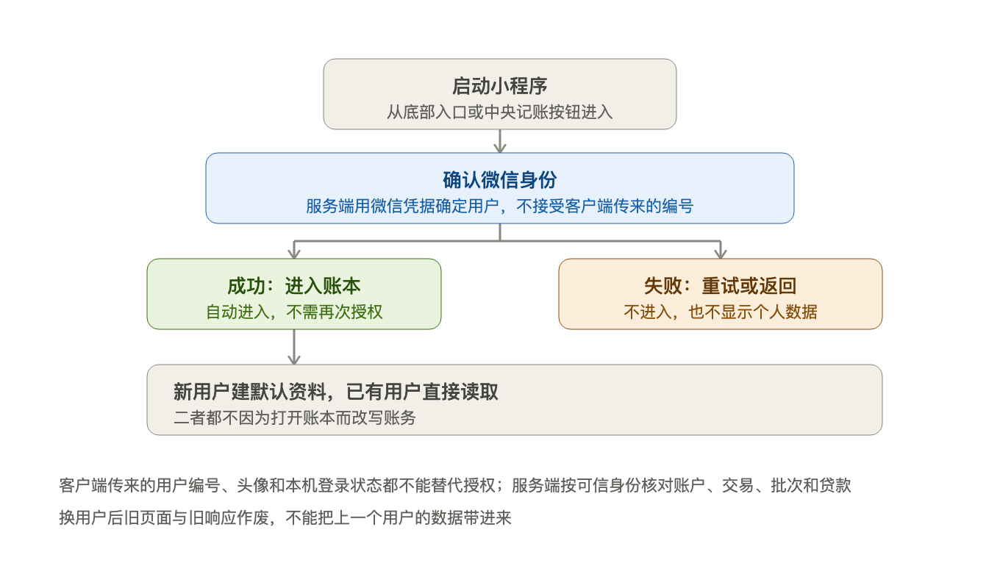

服务端始终使用可信微信身份，并核对账户、交易、批次和贷款是否属于该用户。本机登录状态、头像或客户端传来的用户编号不能替代授权；换用户后旧页面和旧响应不能带入个人数据。

实现与等待规则见[架构设计](招财猫记账本架构设计.md)、[登录保护](../miniprogram/services/login-guard.js)。

## 3. 导入全过程

进入时先开始新导入或恢复原批次；工作台分为“选择文件 → 确认账户 → 核对交易 → 确认入账”。本章按 **开始与准备（3.1～3.3）→ 本机核对（3.4～3.5）→ 正式入账（3.6）** 展开，3.7 补充分期来源规则。

系统先整理原文、事件和问题；用户在本机先确认账户与是否计入，再核对状态、性质和金额，分类可以稍后补。最终由服务端复核并整批入账。图展示处理阶段，下表解释各对象。

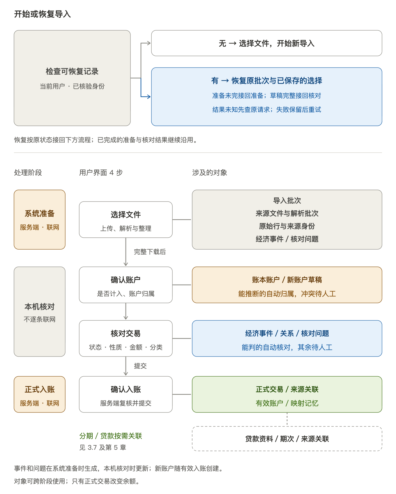

| 对象 | 回答什么问题 |
| --- | --- |
| 导入批次（FinanceUpdate） | 本次一起整理和入账的资料有哪些 |
| 来源文件与解析批次 | 提供了什么，按哪个版本解析 |
| 原始行与来源身份 | 原文是什么，这条来源是否已经见过 |
| 账本账户 | 每笔资金变化记到哪个账户 |
| 经济事件（EconomicEvent） | 多份证据描述的是哪一次资金活动 |
| 核对问题与人工决定 | 哪些事实不清楚，用户作了什么选择 |
| 正式交易（Transaction） | 哪个账户在何时记了多少资金变化 |
| 贷款资料、期次与来源关联 | 计划、实际还款和进度如何对应 |

**只有正式交易改变余额。** 行数、事件数和交易数不同：两份账单描述同一次还款，最终可能是一笔本金转账加一笔手续费支出。

账户归属在 3.4 确认，分类随交易性质核对；账户与分类的管理规则见 4.1。

### 3.1 开始导入与文件准备

先检查是否有可恢复的导入，再决定开始新一批还是继续原批次。

#### 3.1.1 开始或恢复导入

确认登录身份后，系统自动检查当前用户的可恢复记录。

| 进入时的情况 | 处理 |
| --- | --- |
| 没有可恢复的导入 | 选择文件，开始新导入 |
| 有尚未入账的批次 | 恢复原批次与已保存的选择，继续准备或核对 |
| 上次整理或入账已发送，结果未知 | 查询原请求，必要时原样重试；查明结果后继续，不另建批次或重复入账 |
| 恢复失败 | 保留原记录并提示重试；明确放弃前，先查清未知的提交结果 |

恢复未入账批次后，页面先展示第一步，已保存的账户选择和核对结果仍然保留。本机草稿依赖同一设备、同一用户的已保存内容，不保证找回未保存输入或跨设备的未提交选择。保存位置、登录与清理规则见[第 7 章](#recovery)。

实现与验证：[进入与恢复流程](../miniprogram/packages/finance/pages/import-workbench/runtime.js)、[恢复与放弃](../test/import-initial-recovery.test.js)。

#### 3.1.2 收下文件

选完文件后，系统通常自动上传和解析；银行列含义或收支方向不明时，由用户确认后继续。文件按份处理：

| 场景 | 做什么 | 边界与恢复 |
| --- | --- | --- |
| 上传一份文件 | 检查格式、大小、数量和重复选择，传到用户隔离的私有路径，独立解析并显示进度 | 这一份失败只重试这一份，其他成功结果不动 |
| 原位改名 | 只改显示名称，格式后缀固定；上传列表和整理后的来源列表都可改 | 原名、内容、来源身份不变，不重新解析，也不改核对结果 |
| 改名时未保存，或撞名、保存失败 | 先保存或取消，再继续操作 | 名称冲突和保存失败都保留原输入 |
| 首次整理 | 先保存原请求，再整理 | 响应丢失查回或重试同一请求，接回原批次，不新建一批；整理成功但读取失败只刷新结果 |
| 放弃 | 分清单份放弃与整批放弃 | 两者分开处理，各自只作用于自己的范围 |

同一份文件再传一次会怎样，见 [3.3.1](#import-dedup-file)；本表只讲这一趟上传与整理本身的失败与重试。

实现与验证：[导入服务](../cloudfunctions/catledger-import/src/import-service.js)、[文件改名](../test/import-file-rename-ui.test.js)、[首次整理恢复](../test/import-prepare-recovery-db.test.js)。

#### 3.1.3 变成行：解析与列映射

解析就是这一步：按模板识别列、取出字段，原文逐字保留。

| 场景 | 做什么 | 边界与恢复 |
| --- | --- | --- |
| 认模板 | 读文件、工作表、表头与数据行，按支付宝、微信或银行模板解释 | 多个模板或工作表同时成立时不能随手选一个；银行列含义不明先由用户确认 |
| 转统一字段 | 日期、金额、方向、状态、对方、商品、支付方式和交易号转成统一字段 | 同时保留原始列名、位置和内容；空值、零、缺列与占位符分开，不混为一谈 |
| 判结构行 | 空行、重复表头和说明行按结构判断 | 不因文字含“合计”就删除整行 |
| 银行金额形态 | 可能是带符号单列、金额加方向或收支分列 | 带符号单列遵守用户确认的正数方向；取金额绝对值不改变原来的流入／流出 |
| 改表头后 | 重新识别 | 识别成功前不能沿用旧列提交 |
| 收尾 | 得到规范化行、原文定位和文件核验结果 | 无效日期、方向冲突、不支持币种等留下诊断，不能丢掉异常行来凑成功率 |

详见[账单语义与工程验证](现行说明/账单语义与工程验证.md)；实现：[解析器](../cloudfunctions/catledger-import/src/parsers)、[来源模板](../cloudfunctions/catledger-import/src/profiles)。

### 3.2 语义解释：这条记录产生什么经济效果

服务端先按结算状态核实资金效果，再结合来源动作判断性质，最后核对资金归属，形成供用户核对的初步结果。

明确失败或未付款关闭的记录保留证据，不记成功扣款。**未知表示尚不能判断，保留待核对，不能当作没有资金发生。**

收支口径由性质及关系决定，不能只看资金是否跨出账本。退款到账不等于收入，余额调整也不计收支。

| 资金活动        | 对账本的影响         | 收支口径              |
| ----------- | -------------- | ----------------- |
| 普通消费        | 资产减少，或信用账户欠款增加 | 支出                |
| 普通收入        | 收款账户增加         | 收入                |
| 本人账户转账      | 一个账户流出，另一个流入   | 不计收支              |
| 已关联退款       | 收款账户增加，关联原消费   | 冲减支出，分类随原消费       |
| 待关联退款       | 保留真实到账，原消费以后确认 | 暂不计收入，也不作已确认的支出冲减 |
| 借款到账／归还本金   | 资产与负债之间变化      | 本金不计普通收支          |
| 利息、手续费      | 记一次费用；是否已付另行确认 | 支出，规则见第5节         |
| 余额调整        | 校正账户的记账起点或余额   | 不计收支              |
| 分期本金出账／管理进度 | 保存来源或进度        | 不据此虚构资金流水         |

按上面的依据判定后，各类条件的处理去向：

| 条件               | 处理结果                     |
| ---------------- | ------------------------ |
| 动作、状态和方向一致       | 确定资金性质，继续核对账户与关系         |
| 明确失败、未付款关闭或非资金授权 | 保留证据，不记成功扣款              |
| 退款到账             | 查原消费关系，不直接记收入            |
| 本人转账、借款、还款       | 核对端点及本金／费用，不按“收支”字样直接记消费 |
| 未知或矛盾、多账户缺金额组成   | 保留待核对，不能直接入账             |
| 用户明确排除           | 本次不入账，仍保留原文与未识别事实        |

补账户或分类不能解除未知状态、身份冲突、组成不明等问题。普通未知类型可以明确选择适用性质；**未知结算状态当前只有查看原文或排除入口，尚无完整的人工确认资金效果入口**。

自动分类只用于已确认的收入、支出和费用，优先采用同来源的具体“商户＋商品”记忆，再参考用途规则和适用的历史信息。同大类下多个子类冲突时保留大类，跨大类冲突则待分类。平台名本身不证明用途，停用分类不能被自动恢复。

入账或明确补分类后，只学习具体商户／商品证据；同证据出现分类冲突时停用旧记忆。重新整理保留人工选择，已入账记录不自动重分类。

金额使用整数分，接口以字符串传递分值；空值与明确的零分开。现金账户不允许产生或加深负余额。信用额度是资料，贷款本金明细不能再叠加到同一负债账户余额。

实现：[行语义](../cloudfunctions/catledger-import/src/row-semantic-resolver.js)、[分类规则](../cloudfunctions/catledger-import/src/category-rules.js)、[分类映射](../cloudfunctions/catledger-import/src/category-mapping.js)。

### 3.3 去重：同一份证据只算一次

去重不是某一步的动作，而是对同一份证据在三个粒度上各问一次“见过吗”：整份文件、单条记录、已入账的历史。粒度越粗越省事，越细越谨慎——前两个粒度会让这次真的少记一笔，第三个只生成待办。这些判断都在服务端完成，草稿里已经带上结论，核对屏只呈现需要人决定的部分。

#### 3.3.1 文件级：同一份文件再传一次

同一账号下，文件内容哈希相同就不必再解析第二遍；解析结果另有指纹，文件哈希、解析器版本、归一化版本、身份版本和时区都一致，说明上一次的结果仍然可用。

| 再传时的情况 | 处理 | 边界 |
| --- | --- | --- |
| 没入过账 | 复用已有的解析结果和批次 | 不重新解析；只有解析指纹变了才重跑 |
| 已经入账，交易还在 | 判为重复，不产生新批次 | 不新建交易，也不改动已入账记录 |
| 已入账，但交易被删或整批撤回 | 允许重新出批次 | 不复活被删的交易，重导后照常核对 |

只复用证据，不复用上次的入账结果：同一份文件里没入账的部分，这次仍按当前决定重新核对。

#### 3.3.2 记录级：这条记录是否已经见过

**来源身份是证据的身份，不是钱的身份证。** 它只回答“这条来源是否已经见过”。优先采用可靠交易号，其次是同时有效的订单号与商户订单号；都不可用时，才退回文件指纹加行位置。脱敏编号不作为可靠编号。银行还须有可靠账户身份，避免不同卡的流水号相撞。

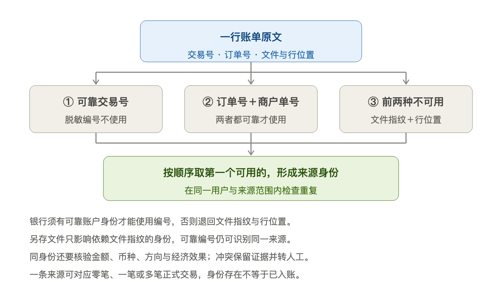

身份算出来后先在全局身份表里查一次，只有四种结果：

| 查到的结果 | 处理 | 说明 |
| --- | --- | --- |
| 第一次见 | 建立身份，正常进入核对 | 这条记录可能记账 |
| 见过，且已挂在正式交易上 | 整行复用，指向原交易 | 不再产生交易 |
| 见过，但没挂交易 | 只复用证据，仍要核对 | 上次没入账、被排除或草稿中断 |
| 见过，但金额、币种、方向或经济效果不同 | 保留冲突，转人工核对 | 不静默覆盖，也不能靠排除别的记录掩盖 |

同一个来源身份，钱数、币种、方向和经济效果必须一致，否则算冲突。唯一例外：同一文件、同一行，金额币种方向都没变，只是我们对经济效果的判定升级了，这时只记一条提示。

改显示名不改变来源身份。另存文件后，可靠编号仍可识别同一来源；**只有依赖文件指纹的记录会受字节变化影响**，这时需重新判断，不能自动认作新交易或同一笔。一条来源最终可能对应零笔、一笔或多笔交易；身份存在不等于已经入账。

身份确定后，再判断多条来源是否描述同一次活动。同额、同日、同商户只构成线索，不能自动合并。需要账户事实的候选，先留成待确认，到 [3.4](#import-accounts) 确认账户后补齐并重验。

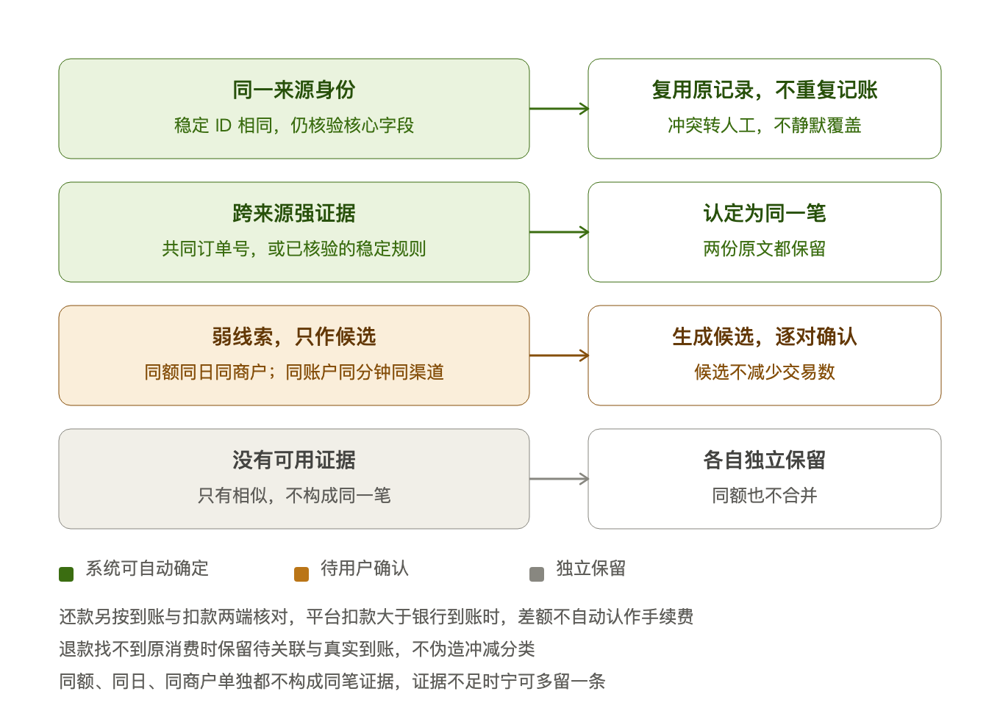

| 关系         | 判断与处理                       |
| ---------- | --------------------------- |
| 本批多份来源可能同笔 | 强证据按明确规则处理；弱候选由用户确认同笔或不同笔   |
| 退款与原消费     | 强且唯一的证据才自动关联；有候选先核对，无候选可待关联 |
| 同身份但核心内容冲突 | 保留冲突，不能靠合并或排除别的记录掩盖         |

银行与支付平台的普通消费／退款没有共同编号时，须同时满足：已确认同一账本账户、金额／币种／方向一致、原始时间精确到同一分钟、银行摘要明确标出对应渠道。只有日期、银行卡尾号或商户文字碰巧含平台名都不够。

还款按银行到账与平台扣款比较，要求本人信用卡、明确渠道和同一本地日期；目标卡冲突不能配对。平台扣款可大于银行到账，但差额不自动算手续费。

**先判同笔，再确认还款明细。** 确认同笔只合并来源，随后核对付款账户、还入账户及差额；明确确认后才可入账，零差额也要确认无手续费。原始两条金额保留。若要修改已确认的固定事实，先拆回原记录再核对。

建议配对依据完整候选范围，双方都只有一个有效候选才进入建议；当前页只有一条不代表唯一。多候选逐对处理，拒绝一对不影响其他候选。批量选择明确展示范围，确认前不减少交易数。可靠来源对的决定可在事实重验后复用，不推广成“同商户／同额都合并”。

确认同笔保留全部原文；修改判断可以拆回多笔或撤回本次历史关联，但不能把同一来源身份拆成多笔再次入账。退款关系、未知状态及贷款保护仍要单独通过。关闭原单与退款存在可靠编号矛盾时，保留整组问题，不能以待关联退款绕过。

#### 3.3.3 关系级：是不是已经记过

前面比的是身份，这一层比的是相似：与已入账交易同额、同账户、同方向，且日期相差 3 天内、时间相差 48 小时内的，会生成“可能已经记过”的待核对项。

**相似只能生成待办，不能产生财务结论。** 系统不会因为看起来像就自动复用或自动跳过；用户在待核对里选择复用原交易（原账目保持）或不重复记。

这类待办会随修改重新计算：改了账户、金额或日期，候选范围就变了，问题会重开或收尾。入账前必须全部解决，否则整批不能提交。

入账事务还会对本批涉及的所有身份加锁复核，防止两个请求同时把同一笔钱记两遍。

解析、语义解释与关系整理走完，服务端手上就是一份完整草稿：全部事件、原文、问题、关系和必要目录，本机一次下载。确认完整、版本一致后才开放账户与交易核对；下载失败保留已有完整草稿，不打开半份结果。

详见[语义专题](现行说明/账单语义与工程验证.md)；实现：[来源身份](../cloudfunctions/catledger-import/src/identity.js)、[证据匹配](../cloudfunctions/catledger-import/src/evidence-matching.js)、[渠道候选](../cloudfunctions/catledger-import/src/bank-channel-matching.js)、[还款核对](../cloudfunctions/catledger-import/src/repayment-channel.js)、[历史重复](../cloudfunctions/catledger-import/src/historical-duplicates.js)。

### 3.4 确认账户：先决定是否计入，再确认归属

进入本机核对后，先确认账单中的账户或支付工具，再决定对应记录是否计入本次账本。

- **不计入**：保留原文，排除明确范围的记录，不生成本次正式交易。
- **计入**：选择已有账户或准备新建账户，再核对资金状态、性质和金额。

本次排除不自动变成永久忽略。账户只保存类型、币种和起点余额，**余额是交易算出来的**，账户本身不产生资金变化。

账单主体回答“文件属于谁”；支付工具引用回答“这一行用了什么工具”；账本账户回答“余额归谁”。支付宝账单可能同时使用余额、银行卡和消费信贷，应按实际账户分别确认。

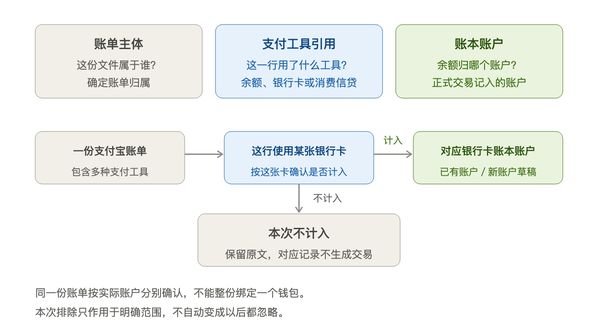

字段 `source_account_id` 表示转出端，不表示文件来源平台。实现见[交易服务](../cloudfunctions/catledger-api/src/transaction-service.js)与[资金账户引用](../cloudfunctions/catledger-import/src/payment-account.js)。

选择计入后，账户归属从低到高采用：**精确推断 → 历史别名 → 历史明确映射 → 本批决定 → 事件级决定**。最高同级仍有冲突时请用户选择，类型不兼容的历史归属不能沿用。

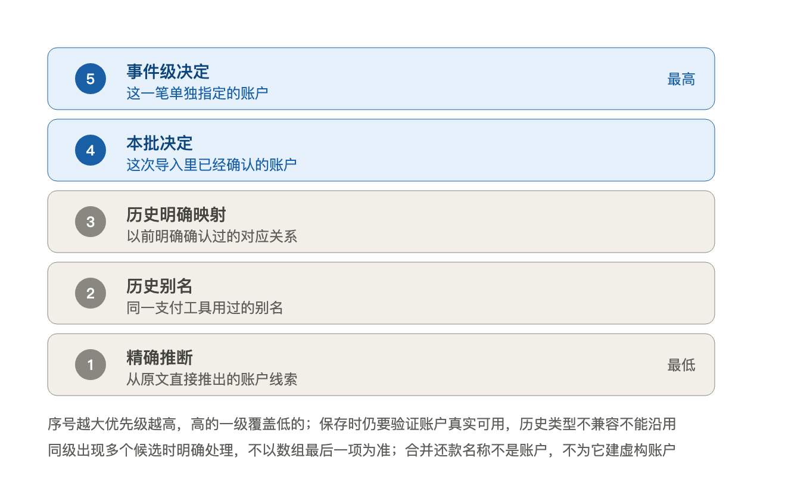

| 场景            | 处理结果                      |
| ------------- | ------------------------- |
| 用户选择不计入       | 本次不入账，不自动变成永久忽略           |
| 已有可靠归属        | 复用，允许修订                   |
| 同一现实账户出现在多个来源 | 合组确认，保留各自来源               |
| 账户不明确         | 待选择，不默认新建或合并              |
| 用户选择新账户       | 先保存本批草稿，有有效入账记录使用时才创建正式账户 |
| 多个付款／收款账户     | 先选真实账户，再确认金额分配，合计必须守恒     |

合并还款名称不是真实账户，不能新建一个同名账户掩盖分项。单笔改账户不改长期映射或其他记录；账户选择也不能修改原始来源金额。

选择先保存到本机，写入成功才显示已保存。空间不足或失败保留最近成功保存的内容。正式提交时服务端重查账户是否可用，再一起保存映射、创建需要的新账户；失效项退回核对，其他决定保留。

实现：[账户映射](../cloudfunctions/catledger-import/src/account-mapping-policy.js)、[账户草稿](../cloudfunctions/catledger-import/src/account-draft.js)、[资金分配](../cloudfunctions/catledger-import/src/funds-allocation.js)。草稿的本地保存与恢复见[草稿本地化方案](导入草稿本地化与保温方案.md)。

### 3.5 核对与保存决定：只改变明确选中的事实

对已选择计入的记录，依次核对资金状态、性质与关系、金额组成。

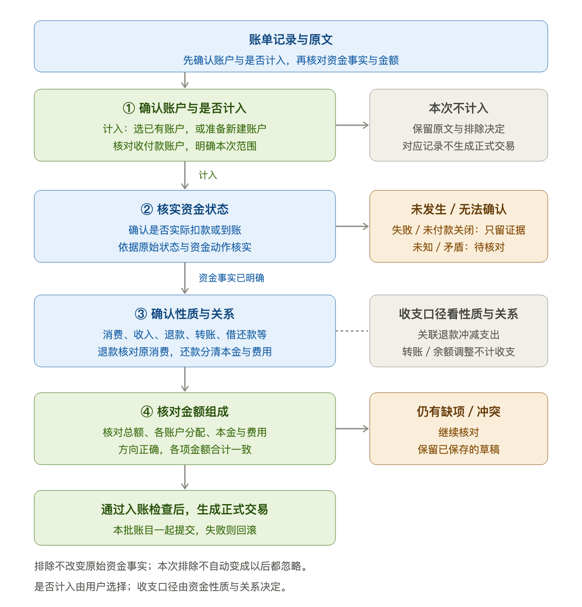

待核对项直接进入当前笔的处理入口；首个问题是同笔判断时先判断关系，其他问题进入统一编辑器。已核对项先查看，再修改核对结果。页面展示原始字段供对照，原文保持只读。

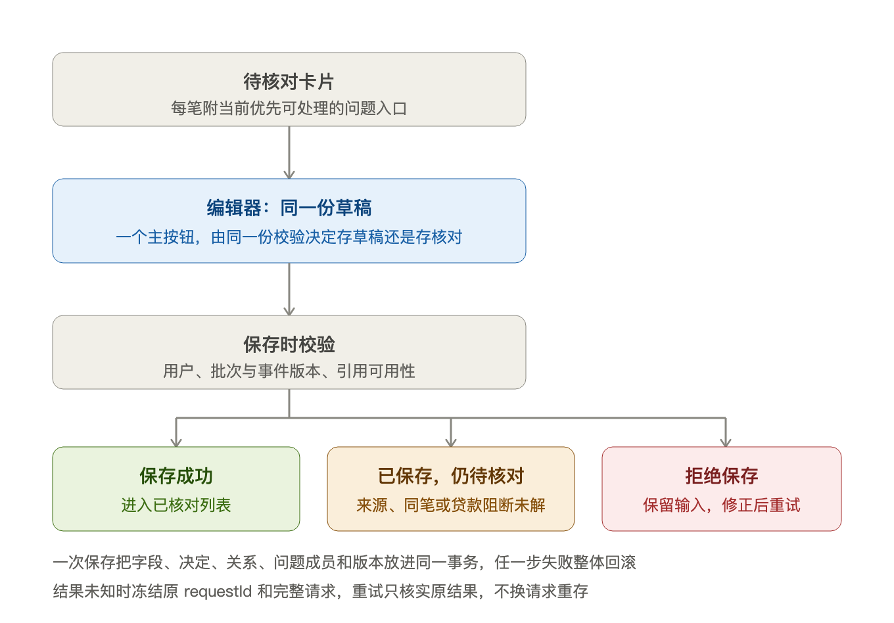

普通修改只作用于当前笔，可修改适用的金额、时间、对方、备注、性质、账户和分类。明确清空对方或备注后不会又被原文补回；切换模式保留暂存输入，但只保存当前模式的适用字段。

| 场景         | 必须确认的内容                     |
| ---------- | --------------------------- |
| 收入／支出／费用   | 适用的收付款账户、金额和日期；分类可以稍后补      |
| 转账／借款／还款   | 明确两端，不能相同；本金、利息、费用需要分清，合计守恒 |
| 组合支付／多目标还款 | 真实账户与每项金额，不能重复账户或超额分配       |
| 退款         | 原消费或待关联状态，日期及累计可退金额；分类随原消费  |
| 分期本金来源     | 确认来源期次和归属，不当成实际扣款或已还证明      |
| 代他人还款      | 明确记支出才按对应方式处理；需收回或不确定时继续待核对 |

已确认的跨渠道还款只允许普通修改付款账户、对方和备注；变更到账、手续费等固定事实，须先修改同笔判断。已记费用只清偿一次，不能通过填写“已计费”绕过依据检查。

退款候选随修改后的金额、日期和账户重新核对。原消费被排除、金额变化或关系失效时，相关退款也要重核。本机未下载的历史范围显示待服务端复核，不能把“本机没找到”当作“账本不存在”。

**保存有三种结果：** 条件齐全进入已核对；合法缺项保存草稿，继续显示待办；金额、日期、账户或分配非法则拒绝并保留输入。补普通字段不能解除来源、身份、同笔或贷款阻断。

核对决定先保存在本机，不逐条上传，也不改变正式余额。最终提交结果未知时冻结原提交，先查明是否成功；明确复核失败后，保留其他决定，只重新处理受影响项。

列表区分待核对、已核对、重复和已排除，按交易日期分页。搜索覆盖当前页签的整个批次，不缩小关系操作或入账范围。排除项保留原文并按实际原因分组；搜索、翻页和后台刷新都不能覆盖未保存输入。

字段边界和交互细则见[统一编辑方案](导入交易统一编辑方案.md)，本地保存与最终提交见[草稿本地化方案](导入草稿本地化与保温方案.md)。实现入口：[编辑模型](../miniprogram/packages/finance/pages/import-workbench/review-editor-model.js)、[页面处理](../miniprogram/packages/finance/pages/import-workbench/review-edit.js)、[服务端核验](../cloudfunctions/catledger-import/src/review/event-review.js)。

### 3.6 确认入账：先过条件，再由一个事务完成

点“确认入账”后，先检查所选范围，再由服务端复核并在同一事务内保存：**全部通过才整批入账；检查不通过则不入账；事务执行失败则整批回滚。**

#### 3.6.1 两把尺子：完整识别与所选范围可入账

完整识别与所选范围可入账分别回答两个问题：

| 指标      | 回答什么问题                           |
| ------- | -------------------------------- |
| 文件完整识别  | 文件观测、字段和受支持控制项是否齐全，每行是否已解释       |
| 所选范围可入账 | 来源归宿是否守恒，所选事件是否全部满足账务条件，是否还有阻断问题 |

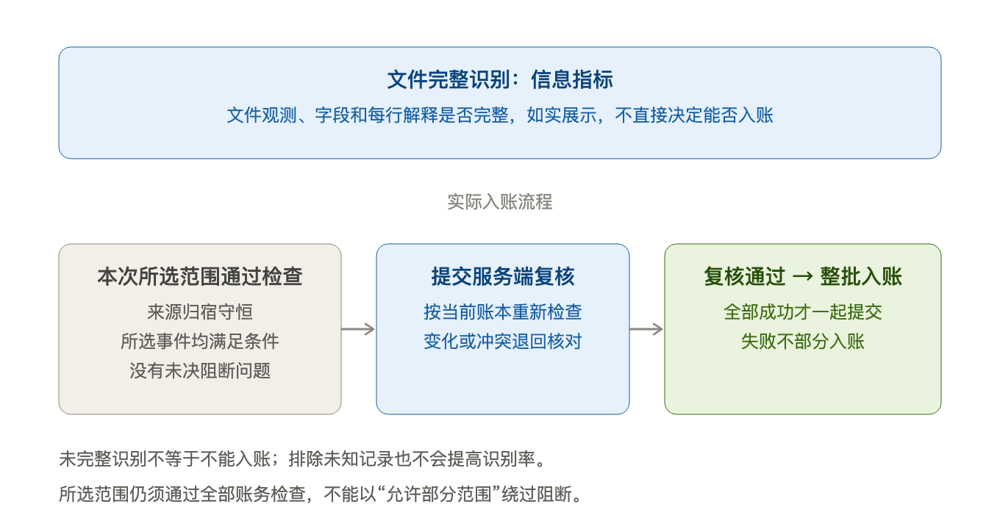

**完整识别不是入账的额外必过条件。** 文件未完整识别时，明确选定且满足条件的范围仍可能入账；但丢失来源、未决冲突或所选事件不合格时不能强行提交。排除未知记录不会提高识别率，分类待补也不等于不能入账。

提交前确保本地决定已保存、草稿完整。系统保存本次固定提交内容，再上传给服务端；暂存不产生正式账务。历史依赖和外部变化由服务端最终复核。

实现与反例：[完整性与入账条件](../cloudfunctions/catledger-import/src/coverage-report.js)、[条件测试](../cloudfunctions/catledger-import/test/coverage-report.test.js)、[提交入口](../miniprogram/packages/finance/pages/import-workbench/posting-flow.js)。

#### 3.6.2 一个事务：成功或整批回滚

服务端先查原请求结果，已经成功则直接返回。新提交核验内容、用户和来源范围后，再进入同一用户的事务完成下图流程。客户端显示“已核对”不能代替这些检查。

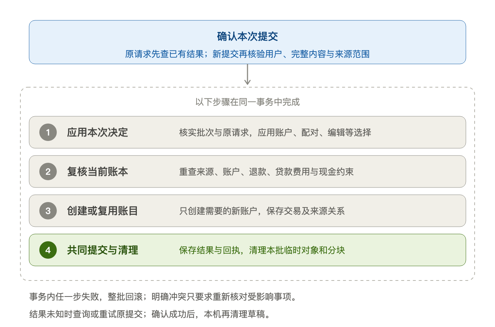

复核包括当前账户和分类、来源占用、历史重复（规则见 [3.3.3](#import-dedup-history)）、退款额度、贷款费用、金额守恒与现金约束。通过后只创建有效事件需要的新账户，保存正式交易、来源关系及映射记忆。新建交易与复用历史交易分开记录，便于后续维护。

分期本金出账只保存来源，不重复记本金；明确费用先查是否已经记过或包含在期初余额中。差额和独立收费须先确认，不能直接再记一笔。

**结果：** 全部成功才提交；任一步失败整批回滚。成功记录、账务变化和服务端临时对象清理一起完成，本机确认成功后再清理草稿。若返回具体冲突，保留其他决定并重新核对；若断网导致结果未知，查询或重试原提交，不能另发一笔。入账成功但明细读取失败，只提示待刷新。

实现：[正式入账](../cloudfunctions/catledger-import/src/finance-update-posting.js)、[本地决定复核](../cloudfunctions/catledger-import/src/local-review-submit.js)、[原请求回执](../cloudfunctions/catledger-import/src/command-result.js)。

### 3.7 分期来源：认出本金与利息，并确定归属

信用卡分期本金出账是应还来源，不代表实际扣款。受支持的分期摘要需同时符合信用卡、方向和期号等条件；缺失或矛盾继续核对，不能仅凭“第几期”推定已还。

同一期可能有多个计划，利息归属依次看：已有人工指定、摘要写明的计划、同账户同一期次是否只有一个候选计划。候选按计划去重，不按本金行数计数。

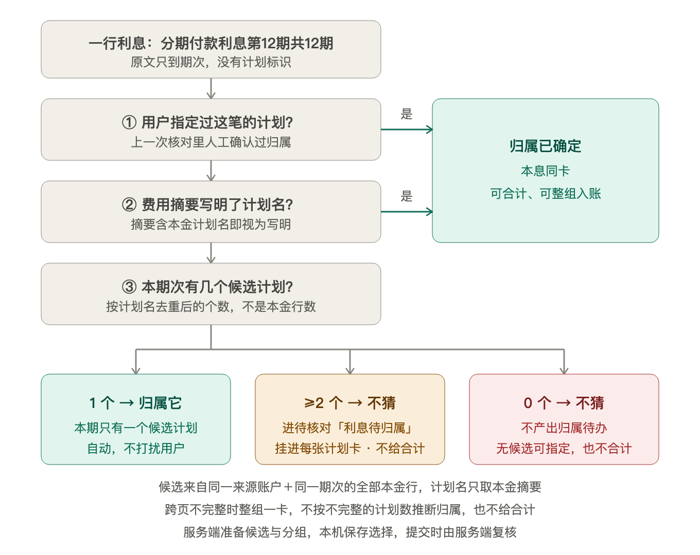

归属明确后按“账户＋计划＋期次”合卡，显示本金与费用合计。多个计划且归属不明时，整组本息留在待核对，未归属费用挂在候选计划卡内；用户选择后保存才生效，全部明确后整组回到已核对。取消指定后仍有歧义，则重新待核对。没有候选计划时保留来源，不制造无从选择的归属待办。

服务端准备时确定候选与分组，本地核对保存用户选择，最终提交由服务端复核。计划名用于说明归属，不能替代交易性质；本息合卡显示“分期出账”，独立费用显示实际费用性质。

入账时本金只保存来源，费用只记一次；之后通过“补充分期记录”关联或新建计划。没有可靠合同编号时，各来源独立保留，不因同账户、同额或同期自动认作同一计划。旧草稿升级保留人工决定，已有冲突需重核，已入账记录不自动改写。

实现：[分期归属](../cloudfunctions/catledger-import/src/installment-plan.js)、[卡片展示](../miniprogram/packages/finance/pages/import-workbench/presentation.js)；详细边界见[贷款与分期方案](贷款与分期改造方案.md)。

## 4. 手工账本、账户、分类与统计

### 4.1 账户和分类

账户保存类型、币种、余额起点和停用状态。期初余额／欠款使用独立调整，资产账户可校正余额，负债没有日常校正入口。额度、账单日和还款日可不填，不显示假零。

停用前说明余额和未结清贷款的限制，不要求虚假清零。恢复时沿用原账户，只解除停用，不改余额或贷款；与活动账户重名时先处理名称冲突。

分类最多两级，父类和子类都可记账，收支类型必须匹配。停用不删除历史，退款沿用原消费分类。默认分类按生活用途组织，初始化只补缺失项，不覆盖用户改名或停用；预设调整通过显式迁移保留原分类与账目关系。

实现：[账户服务](../cloudfunctions/catledger-api/src/account-service.js)、[分类服务](../cloudfunctions/catledger-api/src/category-service.js)、[预设目录](../cloudfunctions/catledger-api/src/default-categories.js)。

### 4.2 手工交易

填写性质、金额、发生时间和适用账户，服务端检查用户归属、分类、退款关系与现金约束后保存。失败保留输入，修改或删除还要核对记录是否已变化、是否受贷款等关系保护。

停用账户不能新增或编辑普通交易，但符合约束的历史交易仍可删除，账户不因此恢复。实现见[交易服务](../cloudfunctions/catledger-api/src/transaction-service.js)。

### 4.3 查询与统计

明细可按日期、账户、分类、来源、备注和导入批次筛选。未分类只表示适用收支记录缺分类，不能把转账等空分类记录全部算入。

新增退款可从原消费发起，也可搜索原消费。只提供有效、日期不晚于退款且仍有可退额度的普通消费；贷款费用从专用入口退费。保存时重新检查累计退款，不能依赖先前页面上的额度。

余额与收支只汇总有效正式交易。已关联退款冲减支出，转账、本金和余额调整不计普通收支；已删除记录退出统计，全期计划不能与已记费用再相加。

首页显示**当前净资产、全账本累计收入和累计支出**，下方趋势按月份展示；统计页按所选月份汇总。期初余额可以使净资产非零，因此累计收入减支出不等于当前净资产。草稿和其他用户的数据不参与汇总。

读取失败时保留已展示结果并提示更新失败，不能把失败显示成“没有账户”或零金额。实现与验证：[统计服务](../cloudfunctions/catledger-api/src/reporting-service.js)、[首页与缓存](../test/home-overview.test.js)。

## 5. 贷款与分期：在逐期表中一次处理

普通流程在逐期表勾选已还并保存，同时补齐缺失利息和手续费，无需另设历史授权步骤。计划、计费和实际付款分别保留依据；只读查看不会自动补历史账。

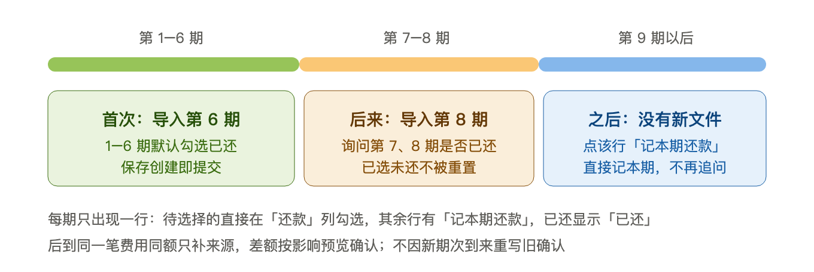

### 5.1 创建与已有账单

从第6期账单创建时，带入已确认账户和来源期次，用户补充原本金、首期日期及还款依据。在原预览表第1～6期逐行选择已还，默认勾选、可以修改；保存才生效，不因看到第6期就自动确认之前全还。

一次保存完成计划、来源关联、已还选择及缺失费用补记，并按所选本金确定接入基准。创建资料不重复原消费，也不虚构放款。

### 5.2 补记历史

缺失费用按确认的期次记到原月，归属该贷款／信用卡账户。已有可靠费用身份或来源先复用；独立手工费用需在预览中“选已记”明确认领。同账户、同月、同额只推荐候选，不能自动认作同一笔。

**每笔新增历史费用，同时生成同额、同账户的余额保全记录。** 过去月份的费用得到补充，当前资产、负债和净资产保持；两条记录绑定维护，不能单独删除。已有费用只补清偿依据，不再补费用或余额调整。一次实收覆盖多期、真实退款都只计算一次。

全部待选择期次完整展示后才可保存；读取不完整或失败保留选择。已经实际付款、部分付款或明确未还的期次不被后续账单覆盖。历史已还确认保留当时金额，后来的计划调整不改历史事实；确认历史不会虚构银行卡扣款。

### 5.3 后来导入与漏月

已有第6期，后来导入第8期：来源放入第8期，询问尚未选择的第7、8期是否已还，默认勾选，保存才生效。之前明确未还或部分已还的期次保持。

后到同一费用且金额相同，只补来源；金额不同先展示影响，再确认净调整。身份冲突、独立收费或已停止的费用不能被自动合并、重新计费。

### 5.4 不再导入时

没有后续文件时，点该期“记本期还款”，带入未付本息费，选择实际付款账户、日期和金额。保存一次完成缺失费用入账、资产账户扣款、本金冲减及期次关联。已有费用只清偿，不能重记；付款账户优先沿用这笔贷款上次的有效选择。

已有信用卡还款账目时，从账目详情“分配到分期”，选择计划及期号，核对本息费和未分配额后保存。各分配加未分配额必须等于原总额；原账户、金额、日期保持，不再扣一次钱。

实际付款只影响明确关联的期次，不推导前面各期全还。替换已有历史确认时只替换对应覆盖，不重复减本金或费用。关联方式记入的还款，更正或撤销关联保留原转账；其他方式按原完整付款组维护。

### 5.5 页面与兼容

已关联借还的账目提供“还款详情”或“放款详情”，通过对应业务维护，不用普通编辑绕过保护。逐期表每期一行：待确认历史可勾选，未还可记本期还款，已还可查看实际记录；编辑、删除在列表底部。

一次性手续费需明确实际金额、日期及账户，或认领已有支出。记在贷款账户表示已计负债，记在资产账户表示已付；明确覆盖多期时只记一次实收，后到同费只补来源，不开启自动记费。

旧自动设置仍按原授权生效，并保留停止入口；保存新的已还选择会停止旧设置。已付、已退款或有来源的费用受关系保护，取消未来计划不伪造退款。

### 5.6 命令、事务与恢复契约（参考）

费用依据、付款、进度和保存结果必须一起成功或回滚。费用身份不随金额、计划版本或本次请求变化；重试同一请求不重记。预览只说明影响，执行时仍复查金额、版本及付款／退款／来源依赖。

完整接口、旧授权、有界同步与维护规则见[贷款专题](现行说明/贷款管理.md)和[统一方案](贷款与分期改造方案.md)；实现与验证入口集中在[专题索引](现行说明/贷款管理.md#7-代码与验证入口)。

### 5.7 删除整笔贷款／分期与重新建立

删除前展示实际影响，用户确认一次后整组执行，未保存的已还选择不随删除提交。

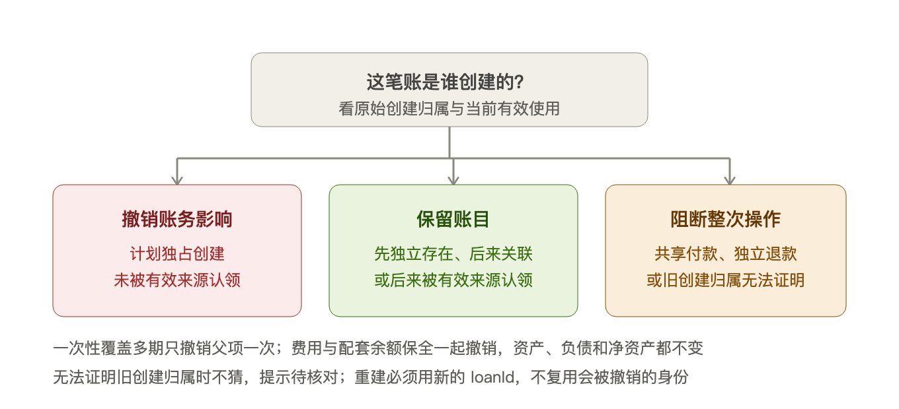

| 范围                         | 处理                   |
| -------------------------- | -------------------- |
| 计划独占新增、没有有效银行来源认领的账        | 撤销账务影响；历史费用与余额保全成对处理 |
| 先独立存在、后来关联的账，或已获有效银行来源认领的账 | 保留账目及必要配套记录；已更正的分项保持 |
| 共享付款、外部退款或无法证明的旧归属         | 阻止整次操作，指向原业务处理，不部分删除 |

成功后解除该计划的有效关联、停止旧自动记费，保留必要历史；不影响原消费、账户、分类、文件和其他计划。旧归档只解除管理关系，不因升级自动变成撤销账务。

重新建立使用新计划。可靠来源身份或用户明确选择原费用合同才可复用，金额／日期相似不够。保留账目可以重新关联，不重复付款；随整组撤销的费用可按新操作记入，用户单独取消的费用不自动恢复。

实现：[删除范围](../cloudfunctions/catledger-api/src/loan-deletion-scope.js)、[整组执行](../cloudfunctions/catledger-api/src/loan-deletion-service.js)、[原付款复用](../cloudfunctions/catledger-api/src/loan-payment-reuse.js)。

## 6. 已入账之后：当前界面与后台能力分开

### 6.1 当前入口

明细点哪笔就处理哪笔。手工交易按规则编辑；导入交易普通修改主要用于分类，不任意改来源金额或账户。支出改分类时同步关联退款，不重写原文。

普通手工与导入账目支持单笔或混选永久删除。先展示并确认完整选择，再检查退款组、同来源付款分配、贷款／费用依赖与现金变化；任一记录不满足条件，整次拒绝，不能部分删除或暗中扩大范围。筛选全选覆盖全部结果，不只当前页。

删除成功后余额和统计更新，专属关系一并清理；共享来源、文件、映射及当时导入成功的事实保留。没有回收站或恢复按钮，误删需重新添加或主动重导；重导仍须核对，其他有效交易继续防重。贷款付款和费用从专用入口维护。

后台保留系统更正、替换与整批撤销能力，当前没有旧维护页面。它们先预览、执行时重验，保留系统历史；只能撤销本批新建内容，不能删除复用的历史交易。外部退款、贷款关系等仍可阻断。

详见[已入账维护](现行说明/已入账账单维护.md)；实现：[普通永久删除](../cloudfunctions/catledger-api/src/transaction-permanent-delete.js)、[系统维护](../cloudfunctions/catledger-import/src/finance-update-maintenance.js)。

## 7. 读取、缓存与失败恢复

### 7.1 状态所有权

| 内容            | 保存位置与用途               |
| ------------- | --------------------- |
| 正式账户、交易、身份与版本 | MySQL，由服务端事务维护        |
| 最近展示结果        | 本机缓存，用于快速显示，更新失败时标明状态 |
| 完整导入草稿与核对决定   | 本机文件，保存未提交工作；不是正式账本   |
| 已发送但结果未知的提交   | 保留原请求和固定内容，用于查回或原样重试  |

完整准备后的核对在本机完成，目录、原文、候选和保存不逐项联网；最终提交再检查当前账本。恢复前须核验登录身份，核验可能联网；注销或换号清理原用户本机资料。进入导入时的分支与可恢复范围见 [3.1.1](#import-entry)。

### 7.2 首页加载：快照先显示，旧数据不冒充最新

首页先显示同一用户的已有快照并标注更新中，再检查已授权的到期费用、读取最新结果。检查失败或仍有变化时保留旧数据并提示待核实，不把旧余额冒充最新结果。跨日、换用户或相关账务变化后需要重查。

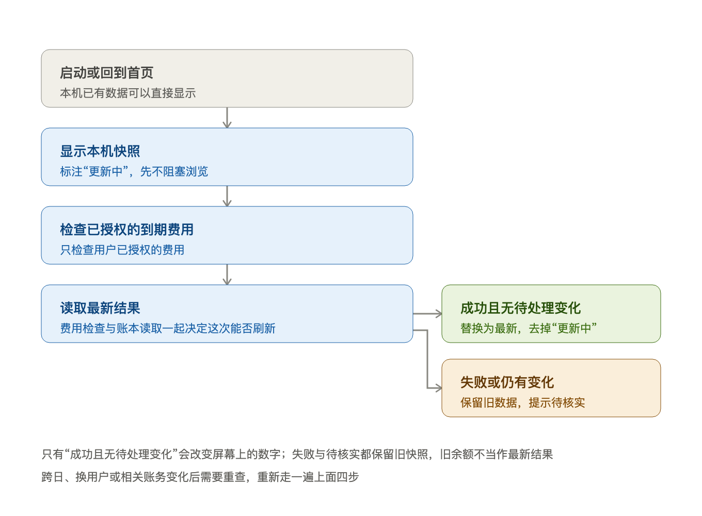

实现：[费用检查](../miniprogram/services/loan-charge-sync.js)。

### 7.3 读可失效，写不能被当作没发生

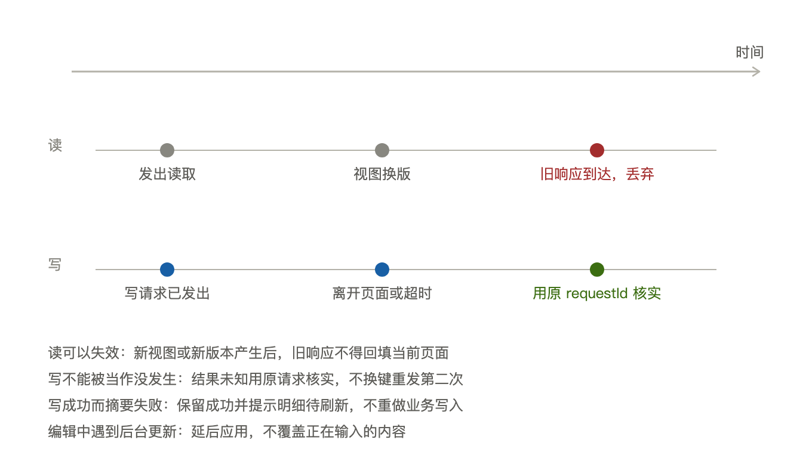

| 场景 | 处理 | 边界 |
| --- | --- | --- |
| 翻页、关闭弹层或换用户后旧结果返回 | 不再回填 | 旧结果不覆盖当前页面 |
| 正在编辑时出现更新 | 保留输入，延后应用 | 不打断正在输入的内容 |
| 写入还未发出就离开 | 不继续旧提交 | 不发出半截请求 |
| 写入已发出，离开或断网 | 保留原请求，查询或原样重试 | 不当作没发生，也不另发一笔 |
| 写成功但结果列表读取失败 | 显示已保存／已入账，列表待刷新 | 不显示成失败 |
| 明确复核冲突 | 保留其他决定，修正受影响项后重新提交 | 不整批作废 |
| 明确放弃，且没有未知提交 | 清理本机草稿；离线时排队处理服务端废弃 | 不声称已实时取消 |
| 普通隐藏或关闭应用 | 保留已保存草稿 | 不当作放弃 |

页面退出不代表服务端回滚，缓存清空也不能当作写入未发生。实现分工见[架构设计](招财猫记账本架构设计.md)，完整保存协议见[草稿本地化方案](导入草稿本地化与保温方案.md)。

## 8. 数据生命周期与规则升级

原件按私有存储规则保留和清理；结构化来源、身份、正式交易与审计分别保存。普通永久删账不等于删除整份文件、共享证据、系统历史或备份。

服务端的导入快照、暂存决定和补充对象用于临时传输；入账成功时与账务一起清理，废弃时也回收。原来源、有效决定关系和回执保留。本机确认成功后清理敏感草稿，清理失败可补做，不能把已入账改成失败。

个人导出提供完整版本的 JSONL 或交易 CSV；导出期间账本变化则重新开始，半份文件不能当作完整导出。用户主动分享并管理副本；目前没有生产恢复按钮。

规则升级保护未入账草稿中的人工决定，已入账事实不因换规则自动改写。数据库迁移显式向前执行，不在升级或读取时自动授权、补记历史费用。

详见[数据生命周期](现行说明/数据生命周期.md)、[开发与验证](开发与验证.md)；版本依据：[领域版本](../cloudfunctions/catledger-import/src/domain-versions.js)、[迁移](../migrations)、[导出清单](../cloudfunctions/catledger-api/src/export-manifest.json)。

## 9. 用四个例子串起来

以下均为合成例子。

| 输入                   | 判断与结果                                             |
| -------------------- | ------------------------------------------------- |
| 支付宝与银行各有一条100元消费     | 各保留原文；可靠证据或人工确认同笔后只记一次消费，同额同日不能直接合并               |
| 30元退款找不到原消费          | 保留真实到账，可待关联；暂不计收入或已确认的支出冲减，之后补关系仍检查退款额度           |
| 平台扣500.50元，信用卡到账500元 | 先确认同笔，再确认差额为手续费；付款账户减500.50元，信用卡欠款减500元，支出只增0.50元 |
| 入账时断网                | 查回原提交；已成功就展示成功，需要重试仍用原请求，不另记一批                    |

贷款第6期、第8期与后续还款的连续例子见[第5节](#loans)。

## 10. 问题先查哪一层

| 现象           | 先检查                    |
| ------------ | ---------------------- |
| 文件或列不能识别     | 模板、列映射、格式与单文件诊断        |
| 有金额仍不能入账     | 状态、性质、账户、组成及关系问题       |
| 补分类仍有待办      | 分类不能代替其他核对             |
| 同额记录被合并或疑似重复 | 来源身份、证据强弱、人工决定和历史账目    |
| 导入后没有贷款      | 本金是否只保存来源，是否还需补充计划     |
| 账单期号被当作已还    | 核对人工确认与实际付款依据，不能只凭最大期号 |
| 没有文件如何记费用    | 逐期还款、历史补记、余额保全与同费复用    |
| 保存后没有刷新      | 先查提交结果，再检查显示更新         |
| 文档与实际页面不符    | 核对路由、运行代码，以及部署和手机验收状态  |

正确性查[业务规则与验收](招财猫记账本业务规则与验收.md)，实现入口查[架构设计](招财猫记账本架构设计.md)，发布与验收查[实施规划](招财猫记账本实施规划.md)。
